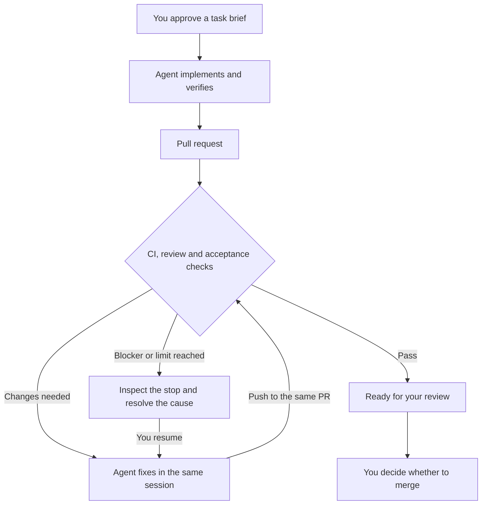
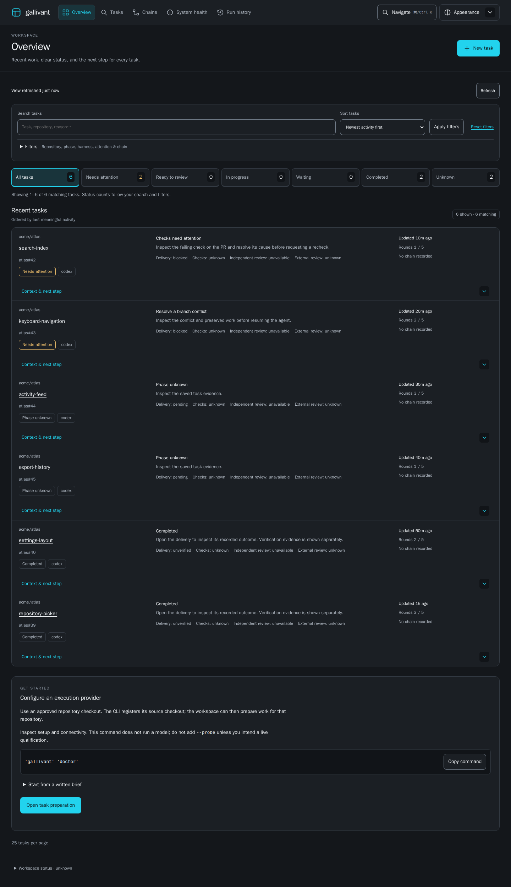

# Gallivant

[](https://www.npmjs.com/package/@uchibeke/gallivant)
[](https://github.com/uchibeke/gallivant/actions/workflows/runtime-portability.yml)
[](package.json)
[](LICENSE)

**Give an agent a task. Let the review loop run. Go outside.**

Gallivant turns a repository task into a reviewed pull request. It runs a coding
agent in a separate checkout, opens the PR, watches CI and reviewer feedback, and
continues the same session until the PR is ready for you. You decide what merges.

Use it when you want to:

- Turn a request or written brief into work with explicit acceptance criteria.
- Keep implementation and review fixes in a separate checkout and one PR.
- Follow progress in a local dashboard, steer the agent and retain the merge decision.

## Contents

- [Set up in one command](#set-up-in-one-command)
- [Finish setup](#finish-what-setup-cannot-do-for-you)
- [Run a first task](#run-a-first-task)
- [How the review loop runs](#how-the-review-loop-runs)
- [While it works](#while-it-works)
- [More than one task](#more-than-one-task)
- [Harness support](#harness-support)
- [Bitbucket Cloud](#bitbucket-cloud)
- [First-party review](#first-party-review-opt-in)
- [Feature map](#feature-map)
- [What to expect](#what-to-expect)
- [Documentation](#documentation)
- [Support](#support)
- [Contributing](#contributing)
- [License](#license)

## Set up in one command

For the recommended GitHub setup, you need the shared tools and **one** of the
two local coding agents below:

| Prerequisite | Check | If it fails |
| --- | --- | --- |
| macOS or Linux, Node 22+, Git, jq | `node --version`, `git --version`, `jq --version` | install from your package manager |
| GitHub CLI signed in | `gh auth status` | `gh auth login` |
| Codex CLI 0.160.0+ signed in | `codex login status` | `codex login` |
| or Claude Code 2.1.263+ signed in | `claude auth status` | `claude auth login` |

Run this inside the Git checkout you want to work in:

```sh
npx --yes @uchibeke/gallivant init --harness codex    # or: --harness claude
```

The setup flow requires **0.2.1 or newer**. `npx` runs npm's latest published
version. Changes merged on `main` become available through npm after a
[versioned release](docs/releasing.md); check the registry with
`npm view @uchibeke/gallivant version`.

`init` writes a private config at `~/.gallivant/config.json`, records this
repository, creates a separate directory for task checkouts, and ends with the
same report as `gallivant doctor`: one line per check and the exact fix for each
failing one. Run it again in another repository to add that repository; nothing
else in the config changes.

A signed-out `gh` or harness stops `init` before it writes anything, and the
message repeats the login command above. `init` never asks for passwords, tokens
or browser cookies; sign in with each tool's own flow. Inference is billed to
your own provider account.

`npx` downloads and runs the package on demand. Nothing is installed globally
and no `gallivant` command is added to your PATH. If you want one:

```sh
npm install -g @uchibeke/gallivant
```

The rest of this page writes `gallivant`. With `npx`, read that as
`npx --yes @uchibeke/gallivant`. Contributors who want to run from a source
checkout: see [installing from source](docs/install.md#install-from-source).

## Finish what setup cannot do for you

`doctor` names these. `init` does not do them, because each needs a decision
from you or an account with a third party.

- **Reviewer.** The default loop waits for the Codex GitHub review integration
  (`chatgpt-codex-connector[bot]`). Enable it on the repository, configure
  another reviewer, or opt into a [qualified first-party reviewer](docs/first-party-review.md).
  Explicit legacy no-review needs both `"reviewer": null` and `review.legacy_no_review: true`. Without one of these, the first PR waits for a review
  that never arrives. See [the reviewer key](docs/config.md#the-reviewer-object).
- **Branch protection.** `doctor` prints the `gh api` call that creates a
  ruleset blocking direct and force pushes to the default branch. Run it
  yourself. Setup never changes repository settings.
- **Harness guardrails.** The APort hook for Claude or Codex is installed by its
  own `npx @aporthq/aport-agent-guardrails` command, and Codex asks you to trust
  the hook inside its own interface. Setup does not install hooks.
  [Guardrails](docs/guardrails.md) explains what each control covers.
- **Spend.** Defaults are 60 fix rounds per PR and a 50 USD per-run cap that
  only Claude enforces natively. Review [limits](docs/config.md) before
  unattended work.

## Run a first task

```sh
gallivant task "Document how to run the existing tests in CONTRIBUTING.md. Use the commands already defined in the repository. Change documentation only." \
  --harness codex --verify 'git diff --check'
# Review the draft, then substitute its returned task ID and revision:
gallivant task start TASK_ID --revision REVISION --run
gallivant start
```

`task` uses your harness to prepare a brief, which is a paid inference call,
and may ask you questions. Review the draft and answer any questions, then use
its printed `Next` action to approve that revision with `task start --run`.
Preparation always returns for review, even if its command includes `--run`.
The agent then works in a clone under `~/.gallivant-worktrees`,
pushes a branch, opens a PR against the default branch, and the daemon watches CI
and the reviewer, sending each round of feedback back to the same session.
`gallivant start` opens the dashboard at **http://127.0.0.1:8791** and keeps
the daemon running; closing the browser does not stop the work.

Expected outcome: a PR with a small CONTRIBUTING.md change and a completion
receipt in its body, and `gallivant status` showing the entry as **ready** once
checks, reviewer and the acceptance gate pass. You review and merge. Missing
access, failing checks or an exhausted round allowance produce an inspectable
stop instead; `gallivant why <handle>` explains it.

### Bring a written brief

```sh
gallivant new add-csv-export
# Edit docs/prds/add-csv-export.md: outcome, scope, acceptance criteria and checks.
gallivant ready docs/prds/add-csv-export.md --check
gallivant ready docs/prds/add-csv-export.md
gallivant start docs/prds/add-csv-export.md
```

You do not have to write a PRD yourself. Both entry points use a validated brief
and the same review loop. [Writing briefs](docs/prd.md) · [Task commands](docs/tasks.md).

## How the review loop runs



The steps below describe the same flow for readers without Mermaid rendering.

1. The agent implements the brief, runs the brief's verification commands and
   opens the PR.
2. Each tick (every two minutes by default) the daemon reads CI and reviewer
   state. A blocking review or a failing check starts a fix round in the same
   agent session, and the fix is pushed to the same PR.
3. Rounds stop at `max_iterations` (60 by default), when the reviewer stays
   silent for `stall_hours`, or when a run exceeds its timeout. Every stop is
   recorded with a reason you can read with `gallivant why`.
4. **Ready** means the configured checks, reviewer and acceptance gate passed.
   Nothing merges automatically. Natural-language tasks stop at a review
   handoff by default; choose `integrated` to keep watching until you merge.

## While it works

The workspace puts decisions and blockers first. **Tasks** focuses the existing
search and filters; **Chains** explains merge waits; **System health** separates
saved capability observations from unknown account access. **New task** prepares
code, documentation or research for a repository pull request, asks questions,
and requires approval of the exact revision before implementation starts.



This is the real served interface with identifiable synthetic tasks and a fixed
clock, not production activity. See the [light overview and mobile task view](docs/ui-qualification.md#approved-captures)
and [browser guide](docs/app.md) for standalone and mounted access.

| What you need | Action |
| --- | --- |
| Follow runs | `gallivant start` or `gallivant status` |
| Correct the agent | **Send message** on its dashboard page; context and existing work are preserved |
| Inspect a stop | `gallivant why <handle>` |
| Continue after fixing a blocker | `gallivant resume <handle>` or **Resume agent** |
| Refresh review and CI | **Recheck PR**; this does not resume a failed agent |
| Stop a task | **Cancel task**, then review and confirm the cancellation scope |
| Keep the dashboard without opening a browser | `gallivant start --no-open` |
| Run only the daemon | `gallivant start --no-server` |
| Stop monitoring and the standalone dashboard | `gallivant down`; existing agent processes continue |

If services fail to start after a task is accepted, retry `gallivant start`
without the PRD path. Do not submit the same task again.

Temporary connection failures have bounded same-session recovery. For DNS errors,
use `gallivant doctor --network https://api.anthropic.com` with your provider's
actual HTTPS origin. [Recovery and troubleshooting](docs/network-recovery.md).

## More than one task

```sh
gallivant chain launch docs/prds/foundation.md docs/prds/integration.md docs/prds/launch.md
```

The next milestone starts only after its predecessor is merged into the planned
base. You can plan longer work while retaining the merge decision.
[Chaining tasks](docs/chains.md).

## Harness support

`init --harness` accepts `codex` and `claude`. Other adapters are configured by
hand in `config.json`; see [configuration](docs/config.md#execution-providers).

| Harness (`harness` key) | Runs on | Prepare requests | Implementation status |
| --- | --- | --- | --- |
| Claude Code (`claude`) | Your host | Yes | Recommended; live usage evidence |
| Codex CLI (`codex`) | Your host | Yes, 0.160.0+ | Recommended; live usage evidence |
| Gemini CLI (`gemini`) | Your host | Written PRDs only | Adapter implemented; unattended end-to-end qualification incomplete |
| OpenCode (`opencode`) | Your host | Written PRDs only | Adapter implemented; unattended end-to-end qualification incomplete |
| Goose (`goose`) | Your host | Written PRDs only | Adapter implemented; unattended end-to-end qualification incomplete |
| OpenAI Agents API (`openai-agents`) | OpenAI-hosted sandbox | Yes, text-only | Hosted adapter implemented; eligible API account, explicit model/environment and live qualification required |
| Codex Cloud (`codex-cloud`) | Codex Cloud | No | New dispatch disabled until the selected environment's repository binding can be verified |

Local Codex, Codex Cloud and the Agents API are distinct integrations. Local
Codex and Claude work independently of the Cloud dispatch restriction.
`openai-agents` supports remote progress, continuation, cancellation and artifact
retrieval; the coordinator verifies returned changes and publishes the PR.
Implemented transport support is not a claim that every account has access or
that the full live lifecycle has passed qualification.

For local harnesses, provider and model selection belongs to that harness's own
configuration. Gallivant has no general per-task local model router and does not
turn a provider API key into a configured harness automatically. Hosted Agents
requires an explicit authorized model; there is no automatic model fallback.
[Hosted setup](docs/install.md#hosted-agents-api-instead-of-a-local-cli) ·
[Detailed capabilities](docs/config.md#execution-providers) ·
[Recorded qualification](https://github.com/uchibeke/gallivant/blob/main/docs/audit/harness-live-validation.md).

## Bitbucket Cloud

Bitbucket Cloud tasks support the same independent local Codex review service as GitHub. The adapter captures an exact same-repository PR comparison through Bitbucket's commit, diffstat, merge-base and source APIs, then the shared service divides large evidence into bounded jobs. Activation still requires a successful live route qualification; until that and the disposable private/public review matrix pass, keep an existing run's explicit legacy no-review policy. A prior public disposable run qualified PR publication and receipt acceptance only, not semantic review. See the [setup, activation limits and troubleshooting guide](docs/bitbucket-review.md). Bitbucket-only setup needs no GitHub sign-in and does not install a pipeline or alter repository settings.

## First-party review (opt-in)

New tasks can pin `external-required`, `first-party-required`, or `both-required`. Repositories with the configured external reviewer retain their existing default. First-party review requires a separately qualified restricted route; it never claims Git-host bot approval. GitHub and Bitbucket Cloud are the only evidence adapters currently implemented. See [selection, qualification and migration](docs/first-party-review.md) and the [current live qualification gap](docs/audit/first-party-review.md). Existing no-review runs keep that requirement until the audited policy command changes them and disclose the absence of semantic review.

## Feature map

| Capability | What you can do | Guide |
| --- | --- | --- |
| Task intake | Prepare a brief from a request, answer clarification questions, inspect revisions and authorize the ready task | [Tasks](docs/tasks.md) |
| Written briefs and context | Define acceptance criteria, verification commands and carried source files | [PRDs](docs/prd.md) |
| Review loop | Watch CI and trusted feedback, continue corrections, recover bounded connection failures and inspect stops | [Commands](docs/commands.md), [recovery](docs/network-recovery.md) |
| Run controls | Message, resume, recheck or cancel from the CLI/dashboard; inspect saved progress and logs | [Dashboard](docs/app.md) |
| Sequential plans | Queue dependent briefs with a merge gate between milestones | [Chains](docs/chains.md) |
| Completion checks | Evaluate acceptance evidence with APort or the explicit local evaluator; choose review handoff or watching for merge | [Guardrails](docs/guardrails.md), [milestones](docs/tasks.md#choose-the-delivery-milestone) |
| Notifications | Configure transition notifications through ntfy | [Configuration](docs/config.md) |
| Embedding and integrations | Use versioned task-delivery operations, Node coordination, MCP and plugin packaging; deployment is separate | [Task delivery](docs/task-delivery.md) |
| Review learning | Collect historical feedback and inspect candidates; rule activation remains unqualified | [Learning](docs/learning.md) |

The [command index](docs/commands.md#command-index) covers every top-level CLI
command and points to the task and learning subcommands. Run `gallivant --help`
for the installed version's flags.

## What to expect

- **Your machine coordinates the work.** Keep it awake, online and running the
  daemon, including when execution is hosted. Gallivant is not a managed service.
- **Your accounts pay for inference.** Subscriptions and API credits differ.
  There is no automatic provider fallback. Review [limits](docs/config.md) before
  unattended work; the default review allowance is 60 rounds.
- **Your permissions apply.** Scope GitHub access to the required repositories.
  Harness permissions, OS sandboxing and optional APort checks are different
  controls. [Security boundaries](docs/guardrails.md).
- **Ready does not mean merged.** Natural-language tasks default to stopping at a
  qualified review handoff. Choose `integrated` to keep watching for your merge.
  Written-PRD runs retain their monitoring behavior. No mode authorizes automatic
  merge, release or deployment. [Delivery milestones](docs/tasks.md#choose-the-delivery-milestone).
- **Learning is experimental.** Review feedback can be collected, but production
  activation of learned rules is not qualified. [Learning](docs/learning.md).

## Documentation

| Need | Guide |
| --- | --- |
| Install and run your first task | [Getting started](docs/install.md) |
| Start from a request, answer questions, inspect results | [Natural-language tasks](docs/tasks.md) |
| Select the typed delivery profile and planner route for a request | [Typed delivery profiles](docs/task-profiles.md) |
| Write a brief or define noncoding acceptance checks | [PRD contract](docs/prd.md) |
| Use API-backed hosted execution | [OpenAI Agents](docs/openai-agents.md) |
| Dashboard messages, controls and recovery | [Dashboard](docs/app.md) · [Commands](docs/commands.md) |
| Models, credentials, limits and notifications | [Configuration](docs/config.md) |
| Plan sequential work | [Chains](docs/chains.md) |
| Embed task delivery in another application | [Task-delivery package](docs/task-delivery.md) |
| Understand internals or recorded qualification | [Documentation index](docs/README.md) |
| Set up from an agent | [Agent setup](docs/agent-setup.md) |
| Release, contribute or report a vulnerability | [Releasing](docs/releasing.md) · [Contributing](CONTRIBUTING.md) · [Security](SECURITY.md) |

**Asking a coding agent to set this up?** Give it the
[setup-agent instructions](docs/agent-setup.md). They cover inspection, the
`npx` command, the points where your login or decision is required, and what a
setup run may not do on its own.

Embedding the same workflow in another application? See
[task delivery](docs/task-delivery.md). Installing this CLI does not deploy a
hosted service or publish a chat plugin.

## Support

Start with `gallivant doctor` for setup checks and `gallivant why <handle>` for a
stopped run. The [recovery guide](docs/network-recovery.md) covers connection
failures and safe continuation.

For bugs, feature requests or questions, [search existing issues](https://github.com/uchibeke/gallivant/issues)
or [open an issue](https://github.com/uchibeke/gallivant/issues/new). Include the
version, operating system, command, expected result and a minimal reproduction.
Remove credentials and private run content before sharing diagnostics.
Report vulnerabilities through the private channel in [SECURITY.md](SECURITY.md).

## Contributing

Documentation improvements, bug reports and pull requests are welcome. Read
[CONTRIBUTING.md](CONTRIBUTING.md) for the contribution workflow and test-host
requirements. To work from source with Node 22 or 24:

```sh
git clone https://github.com/uchibeke/gallivant.git
cd gallivant
npm ci --ignore-scripts
npm run lint
npm test
npm run test:install
```

Native isolation tests require macOS Command Line Tools or Linux Bubblewrap with
user namespaces enabled. The default suite uses fixtures and disposable
repositories; live provider tests are separate opt-in commands that can spend
credits. See the [CI host setup](.github/workflows/runtime-portability.yml) and
[source installation guide](docs/install.md#install-from-source).

## License

Licensed under the [Apache License 2.0](LICENSE).

## Acknowledgments

This README follows [Make a README](https://www.makeareadme.com/), adapted for a
CLI with an existing documentation set: prerequisites, runnable examples,
expected outcomes, support, contribution instructions and licensing.
