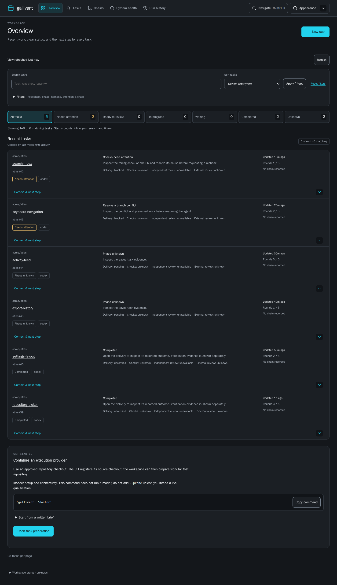
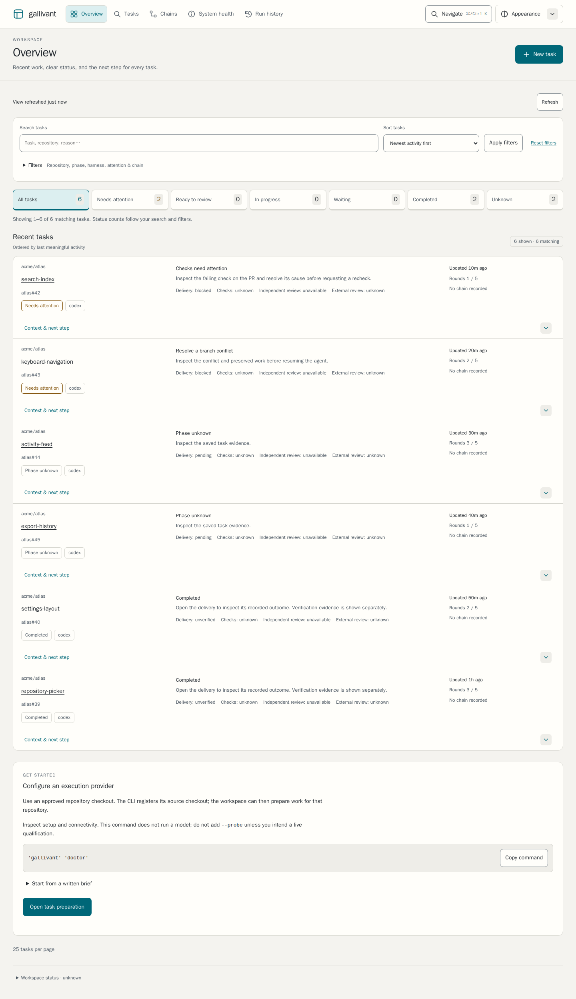
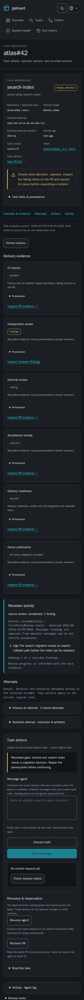
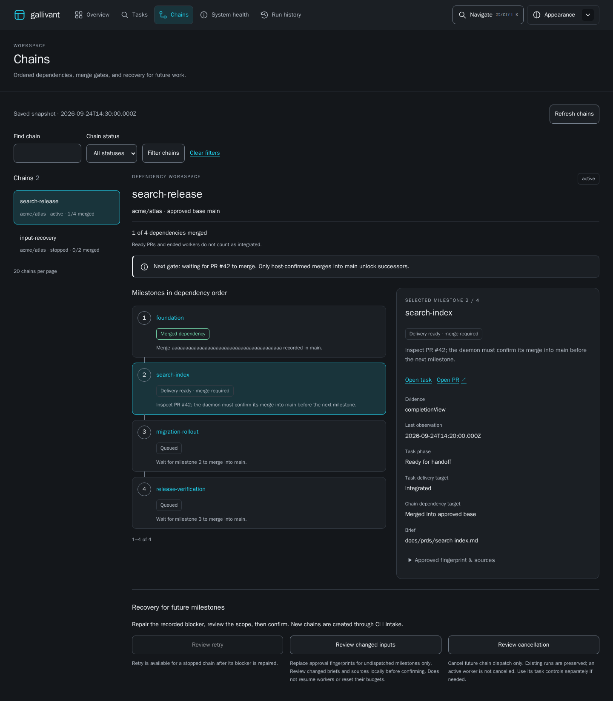

# Qualifying the operator workspace

The overview, task workspace, protected controls, chains, preparation and health
views share the existing server-rendered shell, tokens, read models and request
lifecycle. **Tasks** focuses the overview's existing search with the current
filters. No second task list, approval path or state migration is required.

## Reproduce the release checks

Use Node 22 or 24 and the locked development dependencies:

```sh
npm ci --ignore-scripts
npx --no-install playwright install chromium firefox webkit
npm run lint
npm test
npm run test:ui
UI_INSTALL_BROWSER=1 npm run test:install
git diff --check
```

On Linux, add `--with-deps` to the browser installation. The default installed
package smoke runs without browser binaries on the existing Linux/macOS and
Node 22/24 runtime matrix. `UI_INSTALL_BROWSER=1` additionally launches the
development checkout's driver against the clean installed runtime. It fails if
the browser is unavailable. Neither mode installs browser tooling in the consumer.

The pinned CI container runs as root and sets `HOME=/root` for the job. GitHub's
mounted `/github/home` can belong to a different user; Firefox refuses that
ownership mismatch before any test executes. Keep the container user and its
home consistent for both the source suite and installed-package browser smoke.
This setting applies only to the browser CI container.

`test/ui/fixture.mjs` supplies the real serve/mount handlers, isolated state,
fixed clock and fake execution boundaries. The intake fixture substitutes
inference and execution only; preparation, revision, readiness and control
adapters are real. No production credentials, live model access, host plugin or
paid call is needed. These checks qualify UI behavior, not provider account access.

The separate read-only Browser UI workflow runs all three engines and installed
browser smoke. Runtime portability, isolation, security and release checks keep
their existing gates. Browser failures must not be worked around by weakening
production protections or replacing actual served pages with static HTML.

## Pixel comparisons

Chromium references use Playwright **1.58.2**, Chromium **145.0.7632.0**, Linux
arm64, the bundled Noble fonts, locale `en-US`, timezone UTC and device scale 1.
The container is pinned by digest in `.github/workflows/ui.yml`:

```text
mcr.microsoft.com/playwright:v1.58.2-noble@sha256:6446946a1d9fd62d9ae501312a2d76a43ee688542b21622056a372959b65d63d
```

Inside that environment, run `UI_VISUAL=1 npm run test:ui`. Other platforms run
the semantic suite and explicitly skip the pixel test. Do not compare their
font rasterization to the Linux references. `visual.test.mjs` compares each
full page and its stable filter, control or milestone component. Dimensions
must match and at most 0.1% of pixels may differ by more than 16 channel levels.
References are never updated by the test. To make an intentional visual change,
run `node test/ui/capture.mjs --all-final` in the pinned environment, inspect all
four resulting images, and review their diff before committing.

## Automated coverage and inspection

| Coverage | Reproducible evidence |
| --- | --- |
| Full journey on Chromium, Firefox and WebKit, at root and mounted paths | `test/ui/qualification.test.mjs`: overview/task navigation, protected message feedback, draft recovery, chain selection/history, intake errors, clarification, explicit Start |
| Both themes, 360/390/768/1280/1440 widths and 844 × 390 landscape | `qualification.test.mjs`, plus view-specific suites with expanded hostile content |
| Enlarged content | 200% CSS content zoom at 1280 × 900 and the 640 × 450 CSS viewport equivalent; these are automated reflow checks, not a claim of testing every browser's native zoom implementation |
| WCAG 2.2 AA automated rules | axe in `browser`, `qualification`, `overview`, `workspace`, `controls`, `chains`, `intake` and `health` suites |
| Loading, empty, stale, failed, malformed and long content | View-specific suites, including last-good-snapshot retention, visible unresolved evidence and retry feedback |
| Uncertain mutations | `controls`, `intake` and `chains` suites: saved operation identity, reload, competing tabs and no duplicate submission |
| Cleanup and reading position | Existing lifecycle, cached-page restoration, hidden/offline backoff, selection, focus, scroll and aborted-read tests |

Automated axe checks cannot establish full accessibility conformance. Before a
release, separately inspect keyboard order and visible focus, skip navigation,
dialog focus/return, error association and recovery, both-theme text/control
contrast, and reduced-motion behavior. Review the served product at narrow
widths and enlarged text, including expanded disclosures and cancellation
confirmation. On macOS Safari, Option-Tab includes links when full keyboard
access is off. Record inspection separately from automated results in the PR
receipt; do not label an automated keyboard test a human accessibility audit.

## Deterministic resource bounds

The 1,000-task fixture in `browser.test.mjs` limits the overview to 25 task
records and under 300 KB of rendered body HTML. One existing saved-run read per
task is allowed; host/Git/probe/model calls and state writes are tripwires.
Filtering and pagination never issue per-row transcript requests.

The 10,000-event fixture in `workspace.test.mjs` starts with at most 402 DOM
children (400 events plus markers), loads six bounded history pages, keeps at
most 2,400 replay rows at that point and at most 4,001 children after live
follow. Events stay ordered and deduplicated. Search is over loaded output,
selection pauses follow and new activity does not move the reader. Chain lists
window at 20 chains and 25 milestones. Lifecycle tests assert no overlapping
reads and no surviving subscriptions after navigation.

The task and event tests emit elapsed navigation/tail timings with Node,
browser, OS and architecture. Keep that output in the test run; use the DOM,
request and resource bounds as gates instead of universal timing thresholds.
Keyboard input and local search after loading also exercise responsiveness.

## Approved captures

These are unedited full-page captures of the served synthetic fixture, fixed at
2026-09-24 14:30 UTC. Desktop viewports are 1440 × 1000; mobile is 390 × 844.
The overview retains the M1 fixture so its changed hierarchy and honest unknown
states can be compared with the [foundation](ui/previews/foundation-overview-dark.png).
Task and chain captures use the existing milestone seed helpers.






Approved documentation PNGs ship with the guides so their relative links work
after `npm pack`. Browser drivers, browser binaries, tests and fixture state do
not ship. `test/install-package.mjs` checks the manifest, linked guide images,
all runtime assets and served root/mounted routes from a clean installation.

Restart the tracker after upgrading assets. To roll back this qualification
change, revert its navigation, docs, captures and development checks together;
there is no task-state migration. Lookout remains a separate future decision:
this release adds no Lookout brief, dependency or queued work.
